# ✦ Portfólio — Pedro Felipe Bastos 👨‍💻

> [!NOTE]
> Portfólio profissional bilíngue (PT/EN) com linha do tempo de projetos, **dados ao vivo do GitHub** e formulário de contato com envio real de e-mail.

<table>
  <tr>
    <td width="800px">
      <div align="justify">
        Este repositório contém o <b>portfólio profissional</b> de <b>Pedro Felipe Bastos</b>, estudante de <i>Engenharia de Software</i> na <b>PUC Minas</b>, desenvolvido como o <b>Laboratório 01</b> da disciplina de <i>Desenvolvimento e Integração de Aplicações Web (DIAW)</i>. É uma <b>SPA em React + Vite</b>, traduzida para <b>português e inglês</b>, que reaproveita os projetos de referência do professor (<b>GitHubAPI</b>, <b>WakaTimeAPI</b>, <b>Internacionalizacao_i18n</b> e <b>SecureLoginPUC_React</b>) e tem identidade visual inspirada no template <a href="https://future.framer.website/"><b>Future Folio</b></a>.
      </div>
    </td>
    <td>
      <div>
        
      </div>
    </td>
  </tr>
</table>

---

## 🚧 Status do Projeto

       

| Sprint       | Entrega                                                                                                             |                Situação                |
| :----------- | :------------------------------------------------------------------------------------------------------------------ | :------------------------------------: |
| **Lab01S01** | Repositório, wireframes no Figma, protótipo, navegação e layout principal                                           | ✅ Concluído |
| **Lab01S02** | Sobre (PT/EN), Projetos (timeline dinâmica), Experiências, Contato com envio de e-mail, validações e responsividade |              ✅ Concluído              |
| **Lab01S03** | Deploy na Vercel, ajustes visuais, imagens/GIFs dos projetos e README final                                         |      🟡 Falta publicar na Vercel       |

---

## 📚 Índice

- [Links Úteis](#-links-úteis)
- [Sobre o Projeto](#-sobre-o-projeto)
- [Funcionalidades Principais](#-funcionalidades-principais)
- [Identidade Visual](#-identidade-visual)
- [Tecnologias Utilizadas](#-tecnologias-utilizadas)
- [Reaproveitamento dos projetos da disciplina](#-reaproveitamento-dos-projetos-da-disciplina)
- [Arquitetura](#-arquitetura)
- [Instalação e Execução](#-instalação-e-execução)
- [Deploy](#-deploy)
- [Estrutura de Pastas](#-estrutura-de-pastas)
- [Protótipos](#-protótipos)
- [Demonstração](#-demonstração)
- [Testes](#-testes)
- [Documentações utilizadas](#-documentações-utilizadas)
- [Autor](#-autor)
- [Agradecimentos](#-agradecimentos)

---

## 🔗 Links Úteis

- 🌐 **Site publicado:** [Acesse o portfólio](https://SEU-PROJETO.vercel.app) <!-- TODO: trocar pelo link da Vercel depois do deploy -->
- 🎨 **Wireframes:** [Protótipo no Figma](https://www.figma.com/design/cRP7XXtTkeyHc0advhcqHH)
- 🖤 **Referência visual:** [Future Folio — template para Framer](https://future.framer.website/)
- 🐙 **Repositório:** [github.com/PedroFelipeBastos/Portfolio](https://github.com/PedroFelipeBastos/Portfolio)

---

## 📝 Sobre o Projeto

O objetivo é ter um **site de portfólio profissional** que apresente quem eu sou, o que já construí e como falar comigo, servindo tanto como **entrega acadêmica** quanto como **cartão de visitas** para vagas de estágio.

- **Contexto:** Laboratório 01 de **DIAW** (Engenharia de Software — PUC Minas, 2º período), dividido em três sprints: planejamento e prototipação, funcionalidades principais e hospedagem.
- **O que entrega:** apresentação em dois idiomas, linha do tempo de projetos com imagens e links, trajetória acadêmica, dados ao vivo do GitHub e um formulário que envia e-mail de verdade.

---

## ✨ Funcionalidades Principais

- 🏠 **Home:** o próprio portfólio, com 4 cards que levam aos tópicos — **Sobre mim**, **Projetos**, **Experiências** e **Tecnologias**. O **Contato** fica no menu.
- 👤 **Sobre mim (PT/EN):** foto e um parágrafo curto com formação, área de atuação, interesses e objetivo.
- 🗂️ **Projetos:** linha do tempo do mais antigo ao mais recente, gerada a partir de `src/data/projects.js`, com filtro por categoria. Cada projeto tem página com resumo, tecnologias, equipe, link do GitHub e imagens/GIFs.
- 🎓 **Experiências:** formação (PUC Minas e UFOP) e projetos acadêmicos.
- 🧰 **Tecnologias:** cards da stack e, embaixo, os dados ao vivo do **GitHub** (componentes do projeto _GitHubAPI_). O painel do **WakaTime** (projeto _WakaTimeAPI_) está no código, mas oculto por enquanto.
- ✉️ **Contato:** ícones clicáveis (e-mail, WhatsApp, LinkedIn, GitHub, Instagram), formulário com validação e envio pelo **EmailJS** e hora local de Belo Horizonte.
- 🌐 **PT/EN** com i18next (_LanguageSwitcher_ do projeto _Internacionalizacao_i18n_), no menu e no rodapé.
- 📱 **Responsivo**, do celular ao desktop.

---

## 🎨 Identidade Visual

O design segue o template **[Future Folio](https://future.framer.website/)** (Paul / Craftwork, feito para Framer), recriado em React e CSS puro. Nenhuma imagem ou texto do template foi usado: as imagens são da minha foto e dos meus projetos.

| Elemento              | Escolha                                                                                                                               |
| :-------------------- | :------------------------------------------------------------------------------------------------------------------------------------ |
| **Cores**             | Fundo preto `#000`, texto branco e cinza `#8e8e8e` para textos secundários                                                            |
| **Títulos**           | [Inter Tight](https://fonts.google.com/specimen/Inter+Tight), com espaçamento negativo entre letras                                   |
| **Textos auxiliares** | [Roboto Mono](https://fonts.google.com/specimen/Roboto+Mono) em caixa alta, com `[ COLCHETES ]` nos links                             |
| **Layout**            | Hero centralizado, grade de cards com cantos de 36px e etiquetas em pílula, páginas internas com texto à esquerda e imagens à direita |
| **Cabeçalho**         | Fixo com `mix-blend-mode: difference`, que inverte as cores quando passa por cima das imagens                                         |

---

## 🛠 Tecnologias Utilizadas

### 💻 Front-end

- **Biblioteca:** React 19 (SPA)
- **Linguagem:** JavaScript (ES2022+) e JSX
- **Rotas:** React Router 7
- **Internacionalização:** i18next + react-i18next + detector de idioma
- **Estilização:** CSS puro com variáveis, um arquivo `.css` por componente
- **Build Tool:** Vite 8

### 🖥️ Back-end (serverless)

- **Runtime:** Node.js (Vercel Functions)
- **Funções:** `api/github.js`, `api/wakatime.js` e `api/codando.js` — deixam as chaves das APIs só no servidor
- **Serviços externos:** GitHub REST API, GitHub Contributions API, WakaTime API e EmailJS

### ⚙️ Infraestrutura

- **Hospedagem:** Vercel (deploy automático a cada `git push`)
- **Qualidade:** Oxlint

### 📦 Dependências e bibliotecas

| Pacote                             | Versão  | Para que serve                                     |
| :--------------------------------- | :-----: | :------------------------------------------------- |
| `react` / `react-dom`              | 19.3.0  | Interface em componentes                           |
| `react-router-dom`                 | 7.18.4  | Rotas da SPA e filtro na URL                       |
| `i18next`                          | 26.4.4  | Motor de tradução                                  |
| `react-i18next`                    | 17.0.16 | `useTranslation()` nos componentes                 |
| `i18next-browser-languagedetector` |  8.2.1  | Detecta o idioma (URL, escolha salva ou navegador) |
| `country-flag-icons`               | 1.6.20  | Bandeiras do seletor de idioma                     |
| `@emailjs/browser`                 |  5.0.3  | Envio do formulário de contato                     |
| `react-icons`                      |  5.7.0  | Ícones dos painéis do GitHub e do WakaTime         |
| `vite` _(dev)_                     |  8.3.4  | Servidor de desenvolvimento e build                |
| `@vitejs/plugin-react` _(dev)_     |  6.1.2  | Suporte a React no Vite                            |
| `oxlint` _(dev)_                   | 1.88.0  | Linter                                             |

---

## ♻️ Reaproveitamento dos projetos da disciplina

As integrações seguem os projetos de referência do [repositório da disciplina](https://github.com/joaopauloaramuni/desenvolvimento-e-integracao-de-aplicacoes-web/tree/main/PROJETOS/React), com a mesma estrutura `config/` → `services/` → `components/` → `api/`:

| Funcionalidade                | Projeto de origem           | Arquivos                                                                                                                                                            | O que mudou                                                                                    |
| :---------------------------- | :-------------------------- | :------------------------------------------------------------------------------------------------------------------------------------------------------------------ | :--------------------------------------------------------------------------------------------- |
| GitHub ao vivo                | `GitHubAPI`                 | `components/GitHub/*`, `config/githubConfig.js`, `services/githubService.js`, `api/_github.js`, `api/github.js`                                                     | Usuário `PedroFelipeBastos` e busca desligada; cores do tema escuro em `pages/Stack/Stack.css` |
| WakaTime ao vivo              | `WakaTimeAPI`               | `components/WakaTimeStats/*`, `config/wakatimeConfig.js`, `services/wakatimeService.js`, `api/_wakatime.js`, `api/wakatime.js`, `api/_codando.js`, `api/codando.js` | Painel oculto no site por enquanto (basta voltar o componente em `pages/Stack/Stack.jsx` e cadastrar a chave)                                                |
| Tradução PT/EN                | `Internacionalizacao_i18n`  | `components/LanguageSwitcher/*`, `config/i18nConfig.js`, `i18n/index.js`                                                                                            | Só português e inglês                                                                          |
| Envio de e-mail               | `SecureLoginPUC_React`      | `config/emailJsConfig.js`, `services/sendEmailService.js`, `pages/Contact/ContactForm.jsx`                                                                          | Template de contato no lugar do de recuperação de senha                                        |
| Rotas `/api` no `npm run dev` | `GitHubAPI` / `WakaTimeAPI` | `vite.config.js`                                                                                                                                                    | As três rotas no mesmo plugin                                                                  |

O que foi escrito para este projeto: o layout (cabeçalho, menu, rodapé e cards), as páginas e os dados de `src/data/`.

---

## 🏗 Arquitetura

O portfólio é uma **SPA estática** (React + Vite) com **funções serverless**. A Vercel entrega o `dist/` pela CDN e executa as funções de `api/` só para as integrações que precisam de chave secreta.

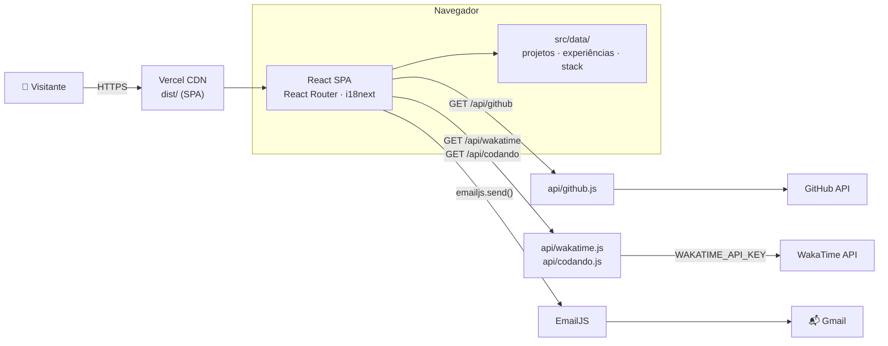

- **Conteúdo como dados:** projetos, experiências e tecnologias ficam em `src/data/*.js`, com campos `{ pt, en }`. A linha do tempo e as páginas de projeto são geradas a partir deles.
- **Chaves fora do navegador:** só os IDs públicos do EmailJS usam o prefixo `VITE_`. A `WAKATIME_API_KEY` e o `GITHUB_TOKEN` são lidos apenas pelas funções em `api/` (na Vercel) ou pelo `vite.config.js` (no `npm run dev`).
- **Code splitting:** a página inicial vem no bundle principal; as outras rotas são carregadas sob demanda com `React.lazy`.

---

## 🔧 Instalação e Execução

### Pré-requisitos

- **Node.js** LTS (20 ou superior)
- **npm**
- Contas no [EmailJS](https://www.emailjs.com/) e no [WakaTime](https://wakatime.com/) (o WakaTime é opcional: o painel está oculto e só precisa da chave quando for reativado)

### 🔑 Variáveis de Ambiente

```bash
cp .env.example .env.local
```

| Variável                   | Onde é usada | Obrigatória | Descrição                                                                                  |
| :------------------------- | :----------- | :---------: | :----------------------------------------------------------------------------------------- |
| `VITE_EMAILJS_SERVICE_ID`  | Navegador    |     ✅      | ID do serviço no EmailJS                                                                   |
| `VITE_EMAILJS_TEMPLATE_ID` | Navegador    |     ✅      | ID do template (usa `{{name}}`, `{{email}}`, `{{message}}` e `{{time}}`)                   |
| `VITE_EMAILJS_PUBLIC_KEY`  | Navegador    |     ✅      | Public Key da conta EmailJS                                                                |
| `WAKATIME_API_KEY`         | Servidor     |     ❌      | Chave do WakaTime (só quando o painel for reativado) ([wakatime.com/settings/api-key](https://wakatime.com/settings/api-key)) |
| `GITHUB_TOKEN`             | Servidor     |     ❌      | Token só de leitura; aumenta o limite da API do GitHub de 60 para 5.000 chamadas/hora      |

> [!WARNING]
> O `.env.local` não vai para o GitHub (`.gitignore`). Nunca use o prefixo `VITE_` na `WAKATIME_API_KEY` ou no `GITHUB_TOKEN`.

### 📦 Instalação e execução

```bash
git clone https://github.com/PedroFelipeBastos/Portfolio.git
cd Portfolio
npm install
npm run dev
```

Acesse **http://localhost:5173**.

| Script            | O que faz                                         |
| :---------------- | :------------------------------------------------ |
| `npm run dev`     | Servidor de desenvolvimento (com as rotas `/api`) |
| `npm run build`   | Gera a versão de produção em `dist/`              |
| `npm run preview` | Serve o `dist/` localmente                        |
| `npm run lint`    | Analisa o código com o Oxlint                     |

---

## 🚀 Deploy

1. Acesse [vercel.com/new](https://vercel.com/new) e importe o repositório **PedroFelipeBastos/Portfolio**.
2. Mantenha o _Framework Preset_ **Vite**.
3. Em **Environment Variables**, cadastre `VITE_EMAILJS_SERVICE_ID`, `VITE_EMAILJS_TEMPLATE_ID` e `VITE_EMAILJS_PUBLIC_KEY` (a `WAKATIME_API_KEY` fica de fora enquanto o painel estiver oculto).
4. Clique em **Deploy**.

> [!IMPORTANT]
> As variáveis `VITE_*` entram no site no momento do build. Se mudar alguma delas na Vercel, faça um **Redeploy**.

O `vercel.json` redireciona as rotas (exceto `/api/*`) para o `index.html`, então links como `/projetos/amplify` funcionam ao recarregar a página.

---

## 📂 Estrutura de Pastas

```
.
├── api/                          # ☁️ Vercel Functions (GitHubAPI e WakaTimeAPI)
│   ├── _github.js / github.js
│   ├── _wakatime.js / wakatime.js
│   └── _codando.js / codando.js
├── docs/imgs/                    # 🖼️ Capturas de tela do README
├── public/
│   ├── favicon.svg
│   ├── og-image.jpg
│   └── projects/                 # Imagens e GIFs de cada projeto
├── src/
│   ├── assets/                   # Foto do perfil
│   ├── components/
│   │   ├── GitHub/               # Do projeto GitHubAPI
│   │   ├── WakaTimeStats/        # Do projeto WakaTimeAPI
│   │   ├── LanguageSwitcher/     # Do projeto Internacionalizacao_i18n
│   │   ├── Header/ Menu/ Footer/ Layout/ Page/ ProjectCard/ Star/
│   ├── config/                   # githubConfig, wakatimeConfig, emailJsConfig, i18nConfig, siteConfig
│   ├── data/                     # 📝 projects.js, experiences.js, skills.js
│   ├── i18n/                     # i18next e traduções (pt-BR, en)
│   ├── pages/                    # Home, About, Projects, ProjectDetail, Experience, Stack, Contact, NotFound
│   ├── services/                 # githubService, wakatimeService, sendEmailService
│   ├── styles/global.css
│   ├── App.jsx
│   └── main.jsx
├── .env.example
├── index.html
├── package.json
├── vercel.json
└── vite.config.js
```

---

## 🖌 Protótipos

Wireframes de média fidelidade da página inicial e da página Sobre mim, feitos no Figma: [abrir no Figma](https://www.figma.com/design/cRP7XXtTkeyHc0advhcqHH).

| Home | Sobre mim |
| :---: | :---: |
| 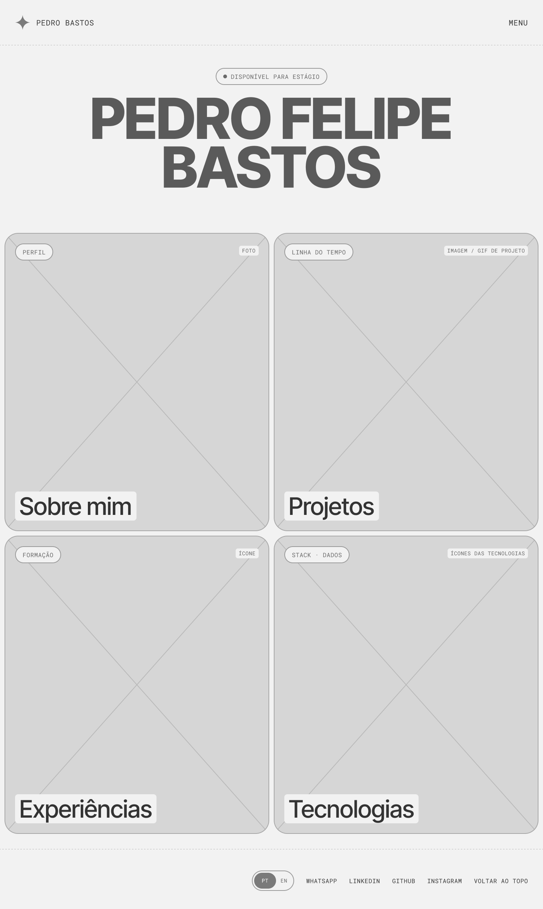 | 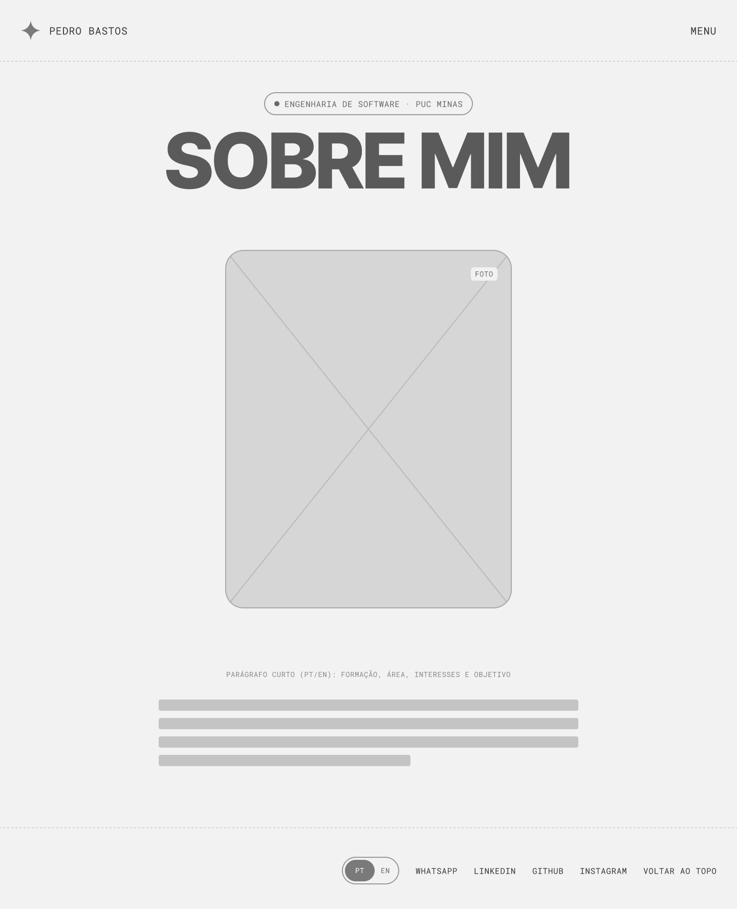 |

---

## 🎥 Demonstração

|                                  Home                                  |                                      Tópicos da home                                      |
| :--------------------------------------------------------------------: | :---------------------------------------------------------------------------------------: |
|                   | 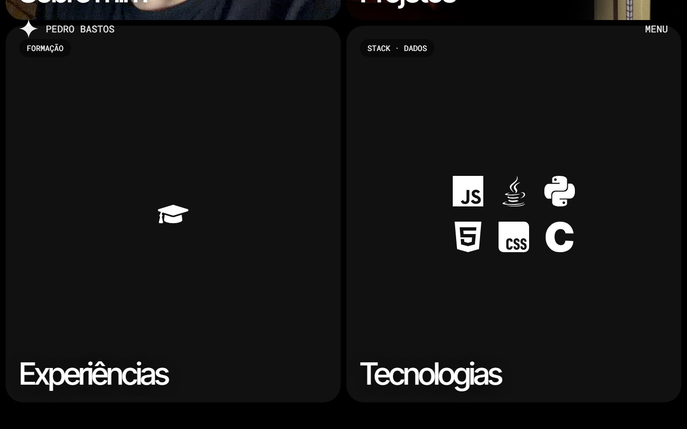 |
|                                **Menu**                                |                                       **Sobre mim**                                       |
|         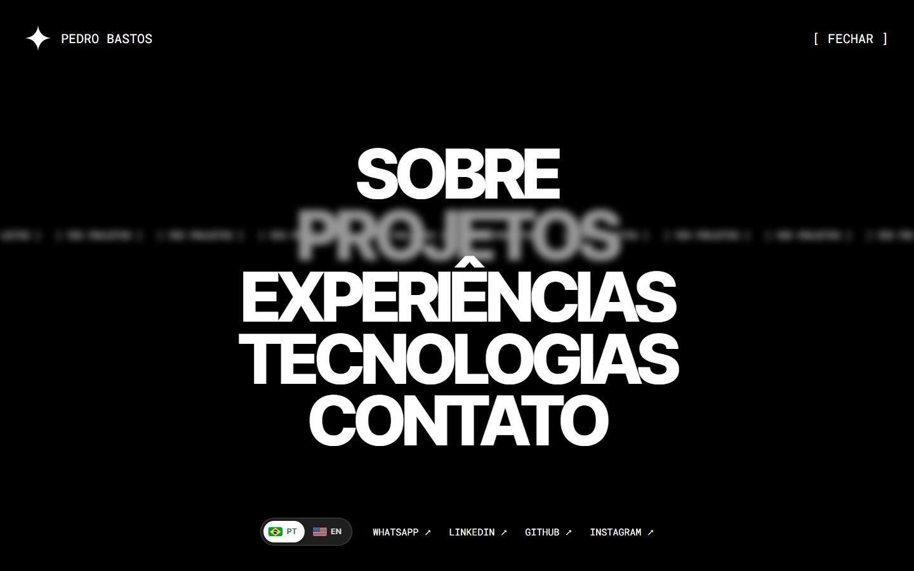          |                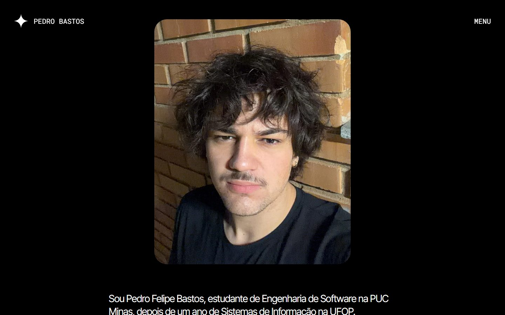                |
|                              **Projetos**                              |                                 **Página de um projeto**                                  |
|  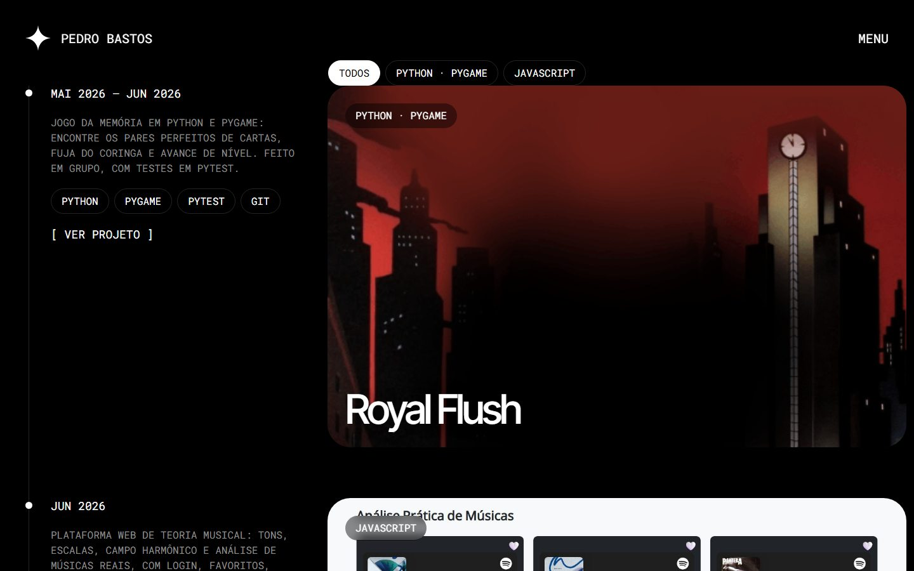   |          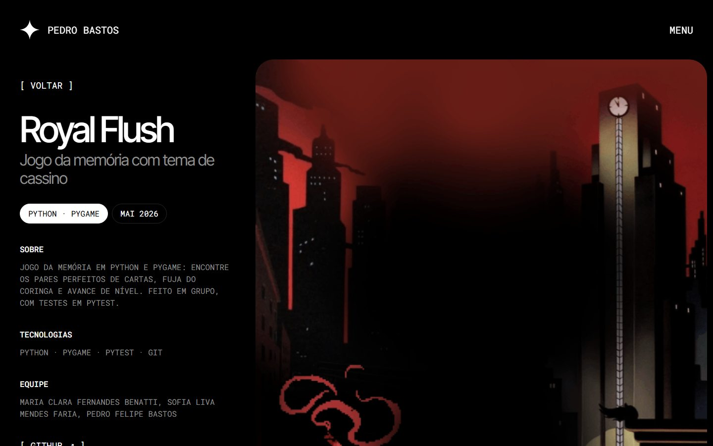          |
|                            **Experiências**                            |                                      **Tecnologias**                                      |
| 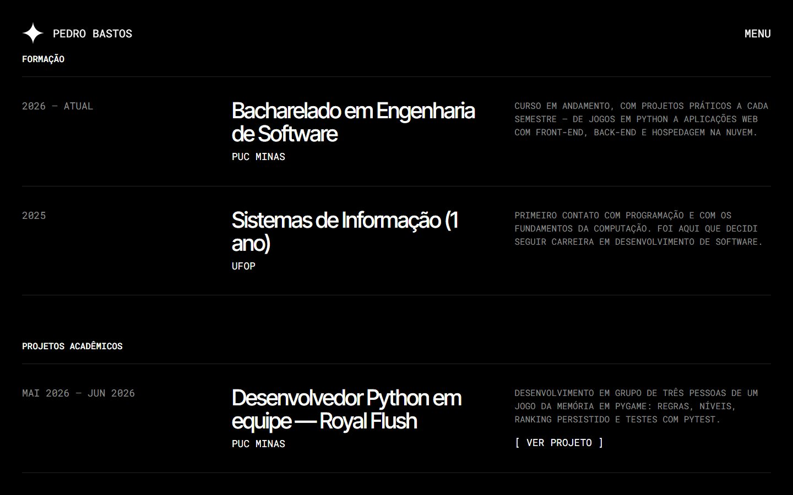  |               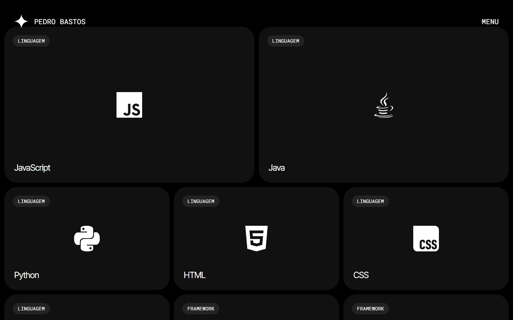               |
|                 **Dados ao vivo (GitHub)**                  |                                        **Contato**                                        |
| 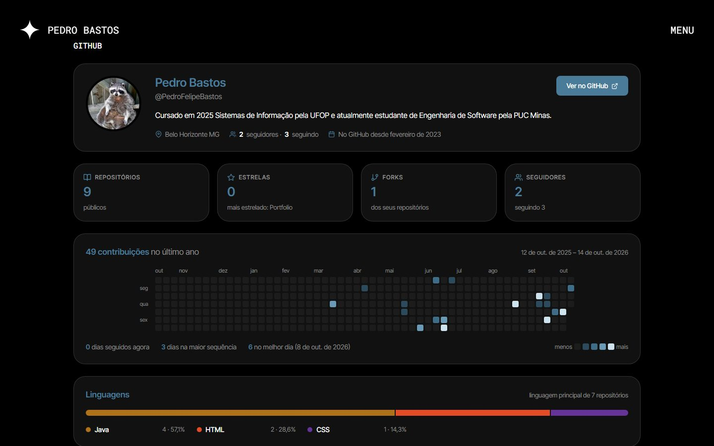 |                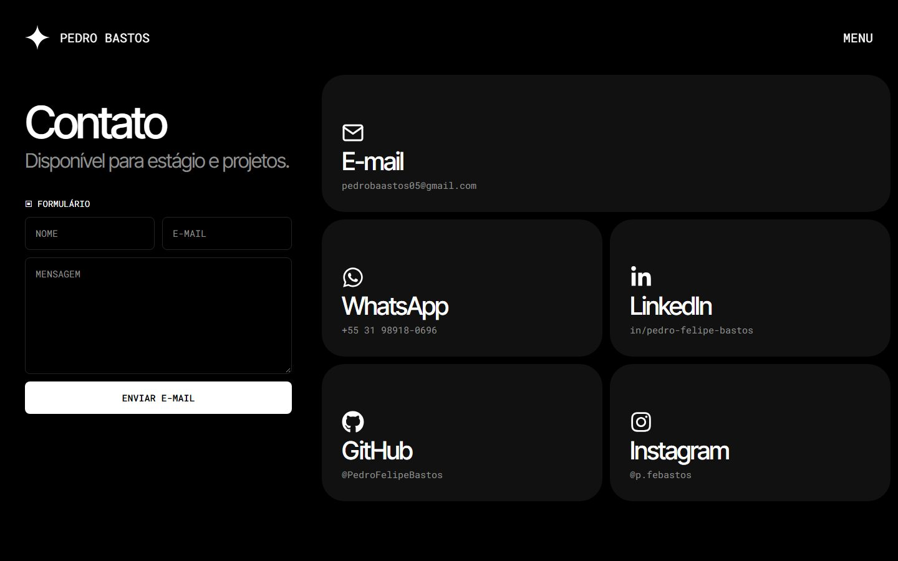                |
|                             **Hora local**                             |                                   **Versão em inglês**                                    |
|  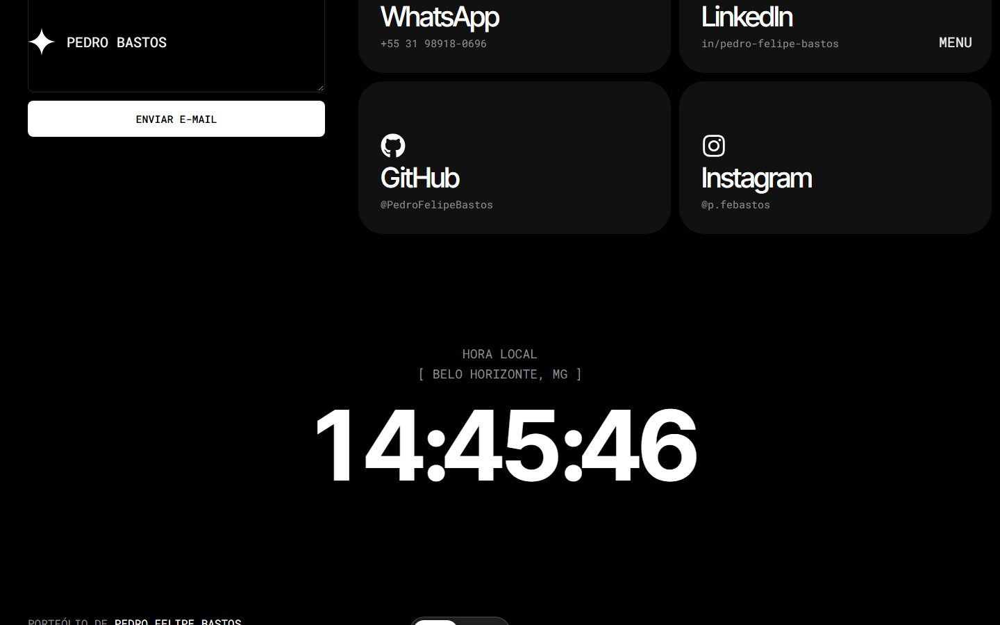   |            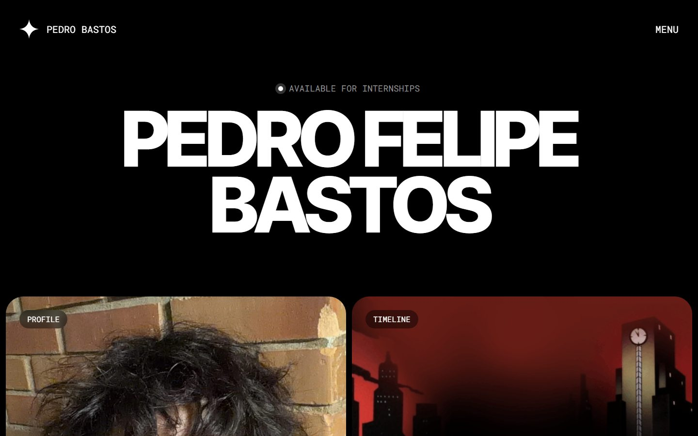             |

### 📱 Celular

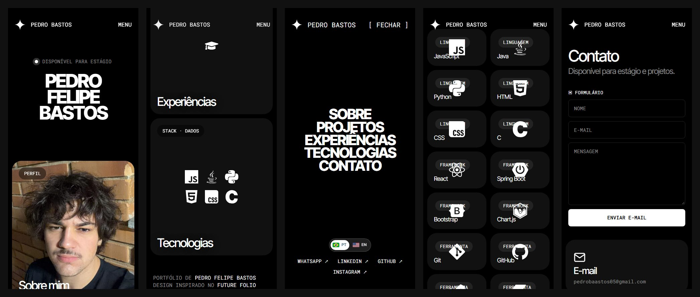

---

## 🧪 Testes

```bash
npm run lint
npm run build
```

O projeto não tem testes automatizados. A verificação foi manual, no desktop (1440×900) e no celular (390×844): navegação entre as rotas, menu, troca de idioma, filtro da linha do tempo, validações e envio do formulário, painel do GitHub com dados reais e ausência de rolagem horizontal no celular.

---

## 🔗 Documentações utilizadas

- 📖 [React](https://react.dev/reference/react)
- 📖 [Vite](https://vite.dev/config/)
- 📖 [React Router](https://reactrouter.com/)
- 📖 [react-i18next](https://react.i18next.com/)
- 📖 [EmailJS](https://www.emailjs.com/docs/sdk/send/)
- 📖 [WakaTime API](https://wakatime.com/developers)
- 📖 [GitHub REST API](https://docs.github.com/rest)
- 📖 [Vercel Functions](https://vercel.com/docs/functions)

---

## 👥 Autor

| 👤 Nome             | 🖼️ Foto                                                                                | :octocat: GitHub                                                                                                                                                         | 💼 LinkedIn                                                                                                                                                                           | 📤 Gmail                                                                                                                                                           |
| ------------------- | -------------------------------------------------------------------------------------- | ------------------------------------------------------------------------------------------------------------------------------------------------------------------------ | ------------------------------------------------------------------------------------------------------------------------------------------------------------------------------------- | ------------------------------------------------------------------------------------------------------------------------------------------------------------------ |
| Pedro Felipe Bastos | <div align="center"></div> | <div align="center"><a href="https://github.com/PedroFelipeBastos"></a></div> | <div align="center"><a href="https://www.linkedin.com/in/pedro-felipe-bastos"></a></div> | <div align="center"><a href="mailto:pedrobaastos05@gmail.com"></a></div> |

---

## 🙏 Consultas

- [**Prof. Dr. João Paulo Aramuni**](https://github.com/joaopauloaramuni) — Projetos de referência reaproveitados aqui.
- **Paul / Craftwork** — Utilizado seu template [Future Folio](https://future.framer.website/), referência da identidade visual.

---
